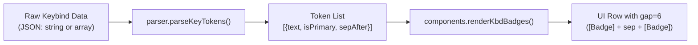

# Design Specification: Keybinds Chord & Sequence Display Support

- **Date:** 2026-10-28
- **Author:** pair-programming agent & rigelyon
- **Status:** Approved
- **Topic:** Keybinds Plugin Chord/Sequence Support & Badge Spacing Refinement

---

## 1. Problem Statement & Motivation

In the Noctalia `keybinds` plugin, keybindings were historically stored as an array of strings in JSON (e.g. `["CTRL", "A", "D"]` or `["Leader", "f", "f"]`) or loaded from Hyprland IPC. The parser assumed all elements except the last were modifier keys joined by `+`, with the final key acting as the primary key.

This produced two notable issues:
1. **Unnatural formatting for chorded / sequential keybinds:**
   - **Tmux keybindings** (such as prefix chords followed by an action key) were displayed as `CTRL + A + D` instead of the canonical `CTRL + A, D`.
   - **Neovim keybindings** (such as `<Leader>ff` or `gd`) were displayed as `Leader + F + F` or `G + D`, which implies pressing them simultaneously, rather than sequential keystrokes separated by space (`[LEADER] [F] [F]` or `[G] [D]`).
2. **Badge Spacing Issue:**
   - In `keybinds/components.luau`, the container `ui.row` for badges used `gap = 2`. The primary action key badge has a filled pill background (`fill = "surface_variant"` with `paddingH = 5`). Because non-primary modifier badges blend into the card's background (`fill = "surface"`), the 2px gap caused the primary key's highlight pill to visually collide / stick directly to the preceding `+` symbol (`CTRL + A +:`, `CTRL + A + D`).

---

## 2. Goals & Non-Goals

### Goals
- **Explicit Key Combo String Format:** Allow `keys` in `presets.luau` and `custom_keybinds.json` to be defined as human-readable strings (e.g. `"CTRL + A, D"`, `"Leader f f"`, `"CTRL + SHIFT + C"`).
- **Multi-Token Chord & Sequence Parser:**
  - Support `,` (comma) as chord step separator (rendered with `,` separator badge/label).
  - Support `+` (plus) as simultaneous key combination separator (rendered with `+` label).
  - Support ` ` (space) as sequential key separator (rendered as distinct badges separated by gap, without any `+` or `,` symbols).
- **Badge Spacing & Visual Refinement:** Increase badge row `gap` from `2` to `6` to ensure comfortable breathing room between highlight pills and separator symbols.
- **Backward Compatibility:** Seamlessly handle existing array format `["CTRL", "SHIFT", "C"]` without crashing or breaking existing custom keybind configurations.
- **Modal Support:** Adapt the Add/Edit modal in `modals.luau` and `crud.luau` so users can enter key combinations directly or use modifier buttons.
- **Data Updates:** Update `presets.luau` Neovim/Tmux presets and the active `custom_keybinds.json` to reflect canonical formats.

### Non-Goals
- Altering Hyprland IPC keybind ingestion (Hyprland binds remain simultaneous combos).
- Changing keybinding execution or interception in Noctalia (the plugin is an informational cheatsheet / quick reference).

---

## 3. Architecture & Data Flow



### 3.1 Token Data Structure
Instead of only returning `modifiers: { string }` and `key: string`, the parser creates a list of tokens:
```luau
export type KeyToken = {
  text: string,          -- e.g. "CTRL", "A", "LEADER", "F"
  isPrimary: boolean,    -- true if final action key of a chord/sequence
  sepAfter: string?,     -- "+", ",", " ", or nil if last token
}
```

The resulting `KeybindItem` includes:
- `tokens: { KeyToken }`
- `keyComboText: string` (e.g. `"CTRL + A, D"`, `"Leader f f"`, `"CTRL + SHIFT + C"`)
- `modifiers: { string }` (fallback for backward compatibility)
- `key: string` (fallback for backward compatibility)

---

## 4. Detailed Component Design

### 4.1 Parser (`keybinds/parser.luau`)
1. **`parser.parseKeyTokens(raw: string | { string }): ({ KeyToken }, string)`**:
   - If `raw` is a table/array: join with `" + "` if not empty, or preserve legacy format.
   - If `raw` is a string:
     - Trim whitespace.
     - Split string by `,` (comma) into distinct steps / chords:
       - Example: `"CTRL + A, D"` $\rightarrow$ Step 1: `"CTRL + A"`, Step 2: `"D"`.
     - For each step:
       - If step contains `+`:
         - Split by `+`, trim each key token.
         - Consecutive keys within the step have `sepAfter = "+"`.
       - Else if step contains space ` ` (and no `+`):
         - Split by whitespace `%S+`.
         - Consecutive keys within the step have `sepAfter = " "` (whitespace / gap).
       - Else:
         - Single key token.
       - The last token of a step (if there are subsequent steps) gets `sepAfter = ","`.
     - The last token of the entire sequence is marked `isPrimary = true` (or tokens in the final action step).
2. **`parser.parseCustomKeybinds`**:
   - Updates to call `parser.parseKeyTokens` for `b.keys`.

### 4.2 Components (`keybinds/components.luau`)
1. **`renderKbdBadges(item: any, cornerRadiusScale: number): { any }`**:
   - If `item.tokens` exists:
     - Iterate through `item.tokens`:
       - Add badge: `components.renderKbdBadge(token.text, token.isPrimary, cornerRadiusScale)`.
       - If `token.sepAfter == "+"`:
         - Insert `ui.label({ text = "+", fontSize = 9, color = "on_surface_variant" })`.
       - Else if `token.sepAfter == ","`:
         - Insert `ui.label({ text = ",", fontSize = 11, fontWeight = "bold", color = "on_surface_variant" })`.
       - Else if `token.sepAfter == " "`:
         - No extra separator label inserted; the row `gap` handles visual separation.
   - Fallback: If `item.tokens` is absent, use legacy `modifiers` and `key` loop.
2. **Row Container Spacing**:
   - In `components.renderKeybindCard`:
     - Change the badges container from `ui.row({ gap = 2, align = "center" }, kbdBadges)` to `ui.row({ gap = 6, align = "center" }, kbdBadges)`.
     - This guarantees 6px clearance on both sides of separator symbols (`+` and `,`), preventing the highlight pill from sticking to `+`.

### 4.3 CRUD & Modals (`keybinds/crud.luau` & `keybinds/modals.luau`)
1. **`crud.addKeybind` & `crud.updateKeybind`**:
   - Accept `keyCombo: string` (e.g. `"CTRL + A, D"` or `"Leader f f"`).
   - Store as `"keys": cleanKeyCombo` in custom store JSON.
2. **`modals.renderAddModal`**:
   - Key field accepts full combo string with placeholder: `"e.g. CTRL + SHIFT + C, CTRL + A, D, or Leader f f"`.
   - Modifier buttons (`SUPER`, `CTRL`, `ALT`, `SHIFT`) act as helper buttons that append/insert modifier text into the key combo input.

### 4.4 Data Updates (`presets.luau` & `custom_keybinds.json`)
- **`presets.luau`**:
  - Update Neovim binds:
    - `"Leader f f"` (Find Files)
    - `"Leader f g"` (Live Grep)
    - `"g d"` (Go to Definition)
    - `"K"` (Hover Documentation)
    - `"Leader e"` (Toggle File Explorer)
    - `"Leader w"` (Save Buffer)
    - `"Leader q"` (Quit Buffer)
  - Add Tmux preset app with canonical `"CTRL + A, <key>"` chords.
- **`custom_keybinds.json`**:
  - Migrate user's existing Tmux and Neovim entries from `["CTRL", "A", "D"]` to `"CTRL + A, D"`, `["Leader", "f", "f"]` to `"Leader f f"`, etc.

---

## 5. Testing & Verification

1. **Parser Unit Tests (`tests/test_keybinds_parser.py`)**:
   - `test_parse_chord_tmux`: `"CTRL + A, D"` $\rightarrow$ tokens `[CTRL (+), A (,), D]`.
   - `test_parse_sequence_neovim`: `"Leader f f"` $\rightarrow$ tokens `[LEADER ( ), F ( ), F]`.
   - `test_parse_simultaneous_standard`: `"CTRL + SHIFT + C"` $\rightarrow$ tokens `[CTRL (+), SHIFT (+), C]`.
   - `test_parse_backward_compat`: `["CTRL", "SHIFT", "C"]` $\rightarrow$ correctly parses as simultaneous.
2. **Components Unit Tests (`tests/test_keybinds_components.py`)**:
   - Verify `components.luau` contains `tokens` rendering, comma handling, and `gap = 6`.
3. **End-to-End Regression**:
   - Run `pytest tests/test_keybinds*.py` to confirm all existing and new tests pass.

