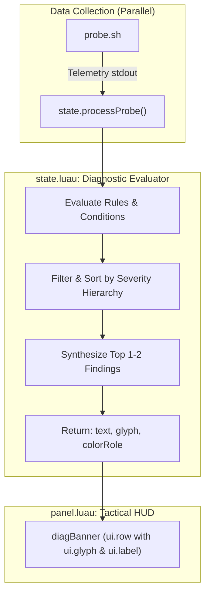

# Smart Diagnostic Banner Synthesis Engine Design Spec

## Context & Goal
The Noctalia `net-radar` plugin features a Tactical HUD panel that currently displays a static diagnostic callout banner based on coarse status categories (`OPTIMAL`, `FAIR`, `POOR`, `CAPTIVE_PORTAL`, `OFFLINE`). 

In real-world usage, users often experience multi-variable network conditions (e.g. weak Wi-Fi signal combined with ISP packet loss). Furthermore, persistent environmental baselines (such as a desk permanently far from the Wi-Fi router) should not cause permanent false-positive warnings or hide more acute issues like ISP degradation.

The goal of this feature is to introduce a **Smart Multi-Issue Diagnostic Synthesis Engine** with **Severity Hierarchy** that:
1. Intelligently evaluates and isolates local Wi-Fi, gateway, internet DNS, and ISP/game server metrics.
2. Treats weak Wi-Fi signal as informational/normal when latency, jitter, and packet loss remain stable.
3. Synthesizes up to 2 concurrent findings into a clear, actionable sentence.
4. Dynamically chooses the appropriate glyph icon and Material Design 3 palette color role.
5. Fully supports English (`en.json`) and Indonesian (`id.json`).

---

## Architecture & Data Flow

---

## Detailed Rules & Severity Hierarchy

### Hierarchy Levels
1. **Tier 1 (Critical / Fatal):**
   - `OFFLINE`: No default gateway found.
   - `CAPTIVE_PORTAL`: Gateway reachable, but internet/DNS blocked.
   - `CRITICAL_LOSS`: Game packet loss $\ge 10\%$.
2. **Tier 2 (Acute / Transient Performance Degradation):**
   - `ISP_ROUTING_LAG`: Local gateway RTT is fast ($< 15\text{ ms}$), but game server RTT is high ($> 120\text{ ms}$).
   - `PACKET_LOSS_MODERATE`: Packet loss between $1\%$ and $9\%$.
   - `HIGH_JITTER`: RFC 3550 jitter $> 15\text{ ms}$.
   - `LOCAL_BUFFERBLOAT`: Gateway RTT $> 30\text{ ms}$ despite strong signal or Ethernet.
3. **Tier 3 (Physical / Environmental Context):**
   - `WEAK_WIFI_PHYSICAL`: Wi-Fi signal $< 40\%$.
     * **Baseline Exception:** If gateway RTT $< 20\text{ ms}$, jitter $< 10\text{ ms}$, and loss is $0\%$, this is classified as `STABLE_WEAK_SIGNAL` (Informational, `primary` color, not a warning).
   - `WIFI_24GHZ`: Wi-Fi connected to 2.4 GHz band ($< 5000\text{ MHz}$) with local jitter.
   - `WIRED_PRISTINE`: Ethernet connection with zero loss and low latency.

---

## Synthesis Rules & Sentence Construction

1. **Single Finding:**
   - Evaluates the top condition and outputs its dedicated translated diagnostic text.
2. **Dual Finding Synthesis:**
   - If a Tier 2 acute issue (e.g. ISP packet loss or high jitter) co-exists with a Tier 3 physical issue (e.g. weak signal or 2.4 GHz band), synthesize both:
     - Indonesian format: `"{primary_clause}, serta {secondary_clause}."`
     - English format: `"{primary_clause}, alongside {secondary_clause}."`
3. **Caps & Constraints:**
   - Maximum 2 issues combined to prevent line overflows or visual clutter.
   - Tier 1 critical issues (`OFFLINE`, `CAPTIVE_PORTAL`) always take exclusive precedence and never combine with secondary findings.

---

## UI & Visual Design

- **Component:** `diagBanner` in `panel.luau`
- **Icon Mapping:**
  - Critical / Loss: `alert-triangle` (`error`)
  - Warning / Jitter / Bufferbloat: `alert-circle` (`tertiary`)
  - Optimal / Stable / Informational: `info-circle` or `check-circle` (`primary`)
- **Container Styling:**
  - `fill = "surface"`, `border = "outline"`, `borderWidth = 1`, `radius = 4`, `paddingH = 10`, `paddingV = 8`.

---

## Localization Keys

### `en.json`
- `panel.diag_offline`: `"No default gateway found. Network is disconnected."`
- `panel.diag_captive_portal`: `"Connected to local router, but internet is blocked. Check captive login."`
- `panel.diag_optimal`: `"Wi-Fi link and game routing are pristine."`
- `panel.diag_wired_optimal`: `"Ethernet wired connection is pristine and stable."`
- `panel.diag_weak_signal_stable`: `"Wi-Fi signal is moderate ({signal}%), but link and game routing remain stable."`
- `panel.diag_isp_loss`: `"ISP or external routing experiencing packet loss ({loss}%)."`
- `panel.diag_isp_lag`: `"Local router is fast, but ISP game routing latency is high ({ms}ms)."`
- `panel.diag_local_bufferbloat`: `"High latency to local gateway ({ms}ms). Potential home network congestion."`
- `panel.diag_high_jitter`: `"Elevated jitter (±{jitter}ms) causing micro-stutter."`
- `panel.diag_wifi_weak_unstable`: `"Weak Wi-Fi signal ({signal}%) causing packet drops."`
- `panel.diag_synthesis_connector`: `"{first}, alongside {second}."`

### `id.json`
- `panel.diag_offline`: `"Tidak ada gateway default. Jaringan terputus."`
- `panel.diag_captive_portal`: `"Terhubung ke router lokal, tapi internet tertahan. Cek halaman login captive portal."`
- `panel.diag_optimal`: `"Koneksi Wi-Fi dan jalur server game sangat lancar."`
- `panel.diag_wired_optimal`: `"Koneksi kabel LAN sangat prima dan stabil."`
- `panel.diag_weak_signal_stable`: `"Sinyal Wi-Fi sedang ({signal}%), namun koneksi router dan game tetap stabil."`
- `panel.diag_isp_loss`: `"Jalur ISP atau server luar mengalami packet loss ({loss}%)."`
- `panel.diag_isp_lag`: `"Koneksi router lokal lancar, tapi latensi server game ISP tinggi ({ms}ms)."`
- `panel.diag_local_bufferbloat`: `"Latensi ke router lokal membengkak ({ms}ms). Kemungkinan bufferbloat jaringan rumah."`
- `panel.diag_high_jitter`: `"Jitter tinggi (±{jitter}ms) berpotensi memicu stutter."`
- `panel.diag_wifi_weak_unstable`: `"Sinyal Wi-Fi lemah ({signal}%) memicu paket hilang."`
- `panel.diag_synthesis_connector`: `"{first}, serta {second}."`

---

## Testing & Verification Plan

1. **Unit Tests (`tests/test_net_radar_diagnostics.py`):**
   - Test offline state returns `panel.diag_offline`.
   - Test captive portal state returns `panel.diag_captive_portal`.
   - Test weak signal ($35\%$) with low gateway ping ($5\text{ ms}$) returns `panel.diag_weak_signal_stable` with `primary` color.
   - Test weak signal ($35\%$) with high gateway ping ($45\text{ ms}$) returns `panel.diag_wifi_weak_unstable` with `tertiary`/`error`.
   - Test dual issue: weak signal + ISP loss ($6\%$) returns synthesized text containing both clauses.
   - Test Ethernet wired low ping returns `panel.diag_wired_optimal`.
   - Test all translation keys exist in both `en.json` and `id.json`.
2. **Regression Testing:**
   - Run `pytest tests/test_net_radar_*.py -v` inside `my-distrobox`.
   - Verify all existing 35 tests continue passing.
