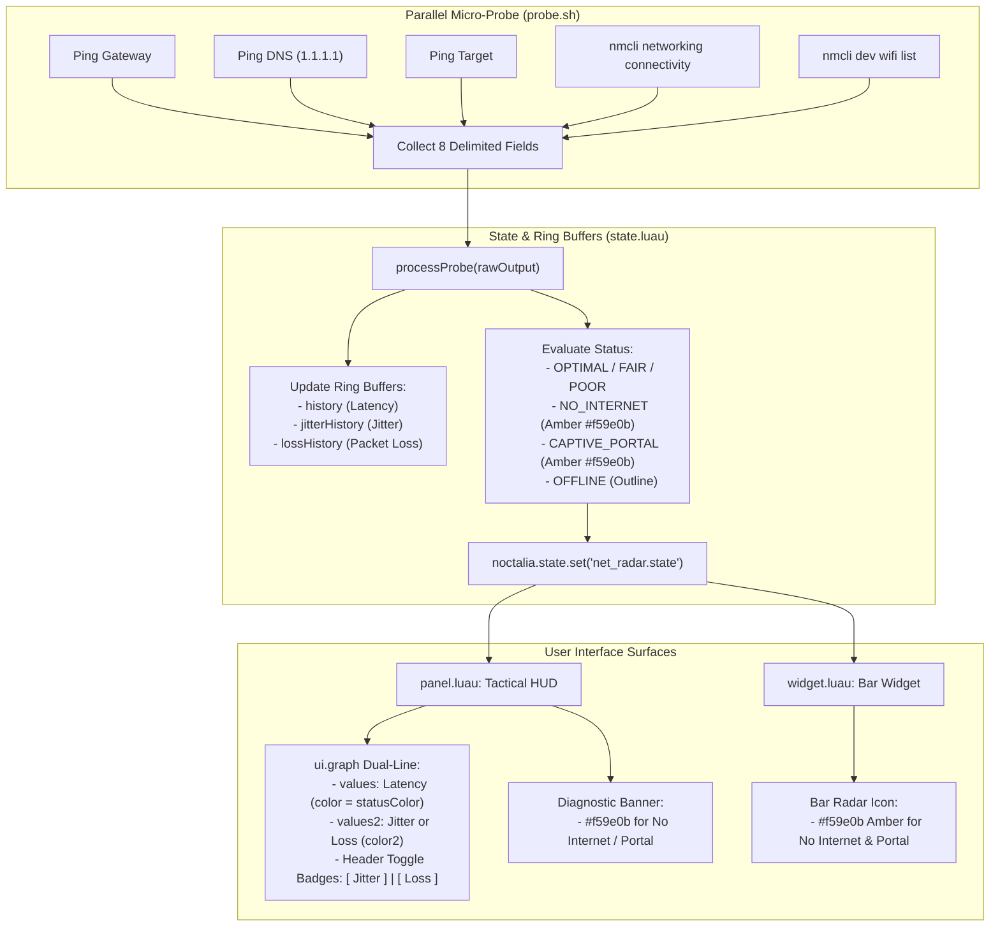

# NetRadar Dual-Line Metrics Graph & Network Connectivity Fix Design Spec

## Context & Goal
NetRadar is a tactical telemetry and gaming latency diagnostics plugin for Noctalia Shell. Currently:
1. The HUD panel features a single `ui.graph` rendering only Latency history over a 60-sample rolling window. Jitter and Packet Loss are only displayed as text values. Users need visual trend lines for Jitter and Packet Loss to diagnose network spikes, micro-stutter, and packet loss bursts over time.
2. Captive Portal detection uses a flawed assumption: if the local gateway pings successfully (`gwMs`), but DNS (`dnsMs`) and game targets (`gameMs`) fail, NetRadar classifies the status as `CAPTIVE_PORTAL`. In home/work Wi-Fi environments where the WAN connection drops, data quota runs out, or ISP routing flaps, this produces false-positive "Captive Portal" warnings.
3. The visual indicator for Captive Portal currently resolves to a greenish/teal tone under some themes (`tertiary`), confusing users into thinking the connection is healthy or online.

The goals of this feature are:
1. **Accurate Connectivity Classification**: Differentiate genuine Captive Portals (via NetworkManager's `nmcli networking connectivity` check returning `portal`) from offline WAN / local-only Wi-Fi (`NO_INTERNET` / `limited`).
2. **Non-Green Amber Color Scheme**: Ensure both `CAPTIVE_PORTAL` and `NO_INTERNET` use Amber/Orange (`#f59e0b`), clearly distinguishing issues from optimal green (`primary`).
3. **Interactive Dual-Line Graph (`values` & `values2`)**: Maintain primary Latency tracking (`values`) while providing an interactive header badge toggle (`[ Jitter ]` / `[ Loss ]`) to dynamically plot Jitter or Packet Loss as the secondary line (`values2`, `color2`).
4. **Comprehensive Ring Buffers & Synchronization**: Store 60-sample buffers for Latency, Jitter, and Packet Loss in `state.luau`, synchronized across surfaces via `noctalia.state`.

---

## Architecture & Data Flow



---

## Detailed Component Specifications

### 1. Probe & Telemetry Collection (`probe.sh`)
- Query NetworkManager's cached connectivity status without rescan latency:
  ```bash
  NM_CONN=$(nmcli -t networking connectivity 2>/dev/null || echo "unknown")
  [ -z "$NM_CONN" ] && NM_CONN="unknown"
  ```
- Output string format updated to 8 pipe-delimited fields:
  ```
  ${GW_MS}|${DNS_MS}|${GAME_MS}|${SSID}|${FREQ}|${SIGNAL}|${RATE}|${NM_CONN}
  ```

### 2. State Management & Ring Buffers (`state.luau`)
- **Buffer Configurations**:
  - `state.BUFFER_SIZE = 60`
  - `state.history = {}` (Latency in ms, -1 for drops)
  - `state.jitterHistory = {}` (RFC 3550 Jitter in ms, 0.0 for initial/no sample)
  - `state.lossHistory = {}` (Rolling Packet Loss %, 0.0 to 100.0)
  - `state.secondaryGraphMode = "jitter"` (`"jitter"` | `"loss"`)
  - `state.nmConn = "unknown"` (`"portal"`, `"limited"`, `"full"`, `"none"`, `"unknown"`)
- **Status Classification Logic (`state.getStatus()`)**:
  1. If `not state.gwMs and not state.dnsMs` $\rightarrow$ `"OFFLINE"`.
  2. If `state.nmConn == "portal"` $\rightarrow$ `"CAPTIVE_PORTAL"`.
  3. If `state.gwMs and not state.dnsMs and not state.gameMs`:
     - If `state.nmConn == "portal"` $\rightarrow$ `"CAPTIVE_PORTAL"`.
     - Else $\rightarrow$ `"NO_INTERNET"`.
  4. If `not state.gameMs` $\rightarrow$ `"POOR"`.
  5. If `state.gameMs < 60.0 and state.jitter < 10.0 and state.lossPct == 0.0` $\rightarrow$ `"OPTIMAL"`.
  6. If `state.gameMs <= 120.0 and state.jitter <= 25.0 and state.lossPct <= 5.0` $\rightarrow$ `"FAIR"`.
  7. Else $\rightarrow$ `"POOR"`.

- **Graph Normalization (`state.getGraphValues()`)**:
  - Primary series (`values`): Latency history normalized $0.0 \dots 1.0$ against `math.max(100.0, maxLatency * 1.25)`.
  - Secondary series (`values2`):
    - When `secondaryGraphMode == "jitter"`: Normalized $0.0 \dots 1.0$ against dynamic jitter ceiling `math.max(15.0, maxJitter * 1.3)`.
    - When `secondaryGraphMode == "loss"`: Normalized $0.0 \dots 1.0$ directly against $100\%$ (`v / 100.0`).
  - Returns: `primaryValues, secondaryValues, minRtt, avgRtt, maxRtt, secMin, secAvg, secMax`.

- **Diagnostics Engine (`state.getDiagnostics()`)**:
  - Tier 1 Fatal conditions:
    - `"OFFLINE"`: `tr("panel.diag_offline")`, `"alert-triangle"`, `"outline"`.
    - `"CAPTIVE_PORTAL"`: `tr("panel.diag_captive_portal")`, `"alert-triangle"`, `"#f59e0b"`.
    - `"NO_INTERNET"`: `tr("panel.diag_no_internet")`, `"alert-triangle"`, `"#f59e0b"`.
    - Critical loss ($\ge 10\%$): `tr("panel.diag_..._loss")`, `"alert-triangle"`, `"error"`.

### 3. Tactical HUD UI (`panel.luau`)
- **Status & Header Colors**:
  - `statusColor` for `"NO_INTERNET"` and `"CAPTIVE_PORTAL"` is explicit Amber `"#f59e0b"`.
  - `renderSegmentedMeter(status)`: Active bars for `"NO_INTERNET"` and `"CAPTIVE_PORTAL"` set to 2 bars with color `"#f59e0b"`.
- **Graph Card with Secondary Mode Switcher**:
  - Header Row:
    - Left: `ui.label({ text = tr("panel.graph_title") })`
    - Right: Interactive Row of 2 badges:
      - `[ Jitter: ±X.Xms ]`: Click sets `secondaryGraphMode = "jitter"`. Highlighted with border/fill when active.
      - `[ Loss: X.X% ]`: Click sets `secondaryGraphMode = "loss"`. Highlighted with border/fill when active.
  - `ui.graph`:
    - `values = primaryValues`
    - `color = statusColor`
    - `values2 = secondaryValues`
    - `color2 = secondaryGraphMode == "jitter" and "#38bdf8" or "#ef4444"`
    - `lineWidth = 2`
    - `fillOpacity = 0.15`
  - Footer Summary:
    - If Jitter active: `Latency: 24-45ms (avg 31ms) • Jitter: ±0.8-4.2ms (avg ±1.5ms)`.
    - If Loss active: `Latency: 24-45ms (avg 31ms) • Packet Loss: 0.0% (peak 5.0%)`.

### 4. Status Bar Widget (`widget.luau`)
- Widget `statusColor` for `"NO_INTERNET"` and `"CAPTIVE_PORTAL"` set to `"#f59e0b"`.
- Tooltip displays localized status strings (`widget.status_no_internet` or `widget.status_captive_portal`).
- Text in bar (if enabled) displays `--ms` or clean label with amber color.

### 5. Localization (`en.json` & `id.json`)
- Add keys:
  - `widget.status_no_internet`: `"NO INTERNET (Local Only)"` / `"TANPA INTERNET (Hanya Lokal)"`
  - `panel.diag_no_internet`: `"Connected to local router, but no internet access."` / `"Terhubung ke router lokal, tetapi tidak ada akses internet luar."`
  - `panel.graph_badge_jitter`: `"Jitter: ±{jitter}ms"`
  - `panel.graph_badge_loss`: `"Loss: {loss}%"`
  - `panel.graph_summary_jitter`: `"RTT: {min}-{max}ms (avg {avg}ms) • Jitter: ±{secMin}-±{secMax}ms (avg ±{secAvg}ms)"`
  - `panel.graph_summary_loss`: `"RTT: {min}-{max}ms (avg {avg}ms) • Loss: {secAvg}% (peak {secMax}%)"`

---

## Verification & Testing Plan

1. **Unit Tests**:
   - `tests/test_net_radar_probe.py`: Verify `probe.sh` outputs 8 fields including NetworkManager connectivity.
   - `tests/test_net_radar_state.py`:
     - Test `processProbe()` with 8 fields, correctly populating `jitterHistory`, `lossHistory`, and `nmConn`.
     - Test `getStatus()` returns `NO_INTERNET` when gateway is reachable, DNS fails, and `nmConn != "portal"`.
     - Test `getStatus()` returns `CAPTIVE_PORTAL` only when `nmConn == "portal"`.
     - Test `getGraphValues()` computes normalized arrays for both `primaryValues` and `secondaryValues` in both `"jitter"` and `"loss"` modes.
   - `tests/test_net_radar_diagnostics.py`:
     - Test diagnostic banner returns Amber `"#f59e0b"` and correct message for `NO_INTERNET` and `CAPTIVE_PORTAL`.
   - `tests/test_net_radar_panel.py`:
     - Test panel renders dual-line graph with `values2` and `color2`.
     - Test badge toggle switches `secondaryGraphMode`.
     - Test segmented meter color and status color use `"#f59e0b"`.
   - `tests/test_net_radar_widget.py`:
     - Test widget uses `"#f59e0b"` for both `NO_INTERNET` and `CAPTIVE_PORTAL`.
   - `tests/test_net_radar_manifest.py`:
     - Validate translations across `en.json` and `id.json`.
2. **Regression Check**:
   - Run entire test suite inside `my-distrobox`:
     `distrobox enter my-distrobox -- pytest tests/test_net_radar*.py`
