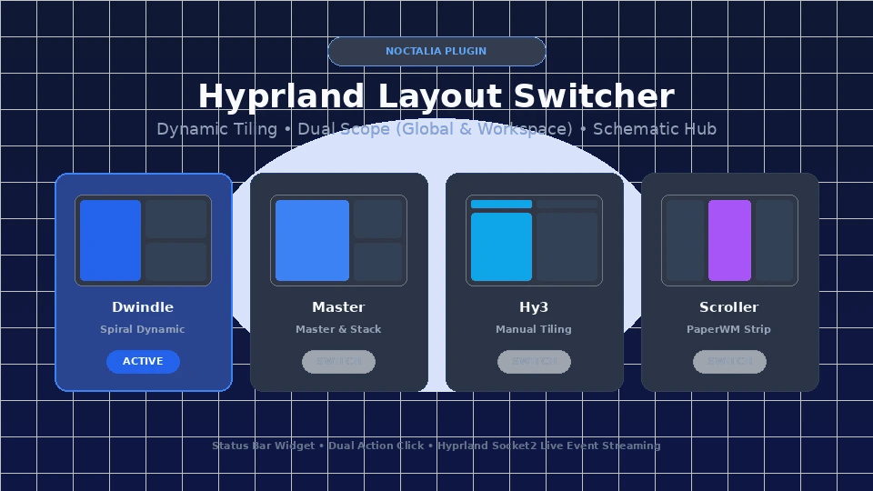

# Hyprland Layout Switcher



An aesthetic, intuitive layout switcher plugin for Noctalia on Hyprland. Switch seamlessly between tiling layouts globally or specifically for your active workspace with real-time feedback and schematic window wireframe previews.

## Plugin

| Field | Value |
| --- | --- |
| ID | `rigelyon/hypr-layout` |
| Entries | Bar widget: `widget`; panel: `panel` |

## Requirements

- `hyprland`: The Wayland compositor (`hyprctl`).
- `socat` *(optional, recommended)*: Enables instantaneous socket2 event streaming.
- Noctalia v5 (Plugin API 28+).

## Usage

Add the `widget` bar widget to your status bar layout in Noctalia Settings, or click it to cycle layouts or open the layout hub. You can also toggle the `panel` directly from a Hyprland keybind or terminal command:

```sh
noctalia msg panel-toggle rigelyon/hypr-layout:panel
```

To bind this in your Hyprland configuration:

```ini
bind = $mainMod, L, exec, noctalia msg panel-toggle rigelyon/hypr-layout:panel
```

### Features

- **Dual-Action Status Bar Widget**:
  - **Left Click**: Instantly cycle to the next enabled layout (`dwindle` → `master` → optional plugins).
  - **Right Click**: Open the visual **Layout Hub** floating panel.
  - Active layout name and glyph visible directly in your status bar.

- **Schematic Window Wireframe Previews**:
  - Miniature diagrams illustrate how windows tile in each layout:
    - **Dwindle**: Fibonacci spiral arrangement.
    - **Master**: Dominant master column flanked by stacked slave windows.
    - **Scrolling**: Horizontal carousel tape of window columns (PaperWM style).
    - **Monocle**: Single-window focus filling the entire workspace.
    - **Hy3**: Manual container groups and tabbed windows (optional plugin).

- **Dual Scope Control**:
  - **Global Session**: Applies layout changes compositor-wide via `hyprctl eval` / `hyprctl keyword`.
  - **Workspace Specific**: Applies layout changes targeting only the active workspace.

- **Context-Aware Sub-Actions**:
  - Quick buttons for layout-specific dispatcher messages:
    - *Dwindle*: Toggle Split, Pseudo-tile, Swap Split.
    - *Master*: Swap Master, Cycle Next, + Master, - Master.
    - *Scrolling*: Center, Fit Active, Resize Col, Swap Col.
    - *Monocle*: Cycle Next, Cycle Prev.
    - *Hy3*: Group Horizontal, Group Vertical, Tabs.

- **Real-Time Hyprland Socket2 Sync**:
  - Listens to Hyprland's UNIX domain socket stream (`.socket2.sock`) for instant zero-latency updates when workspaces change or configurations reload.
  - Graceful fallback when running in non-Hyprland environments.

## Settings

| Setting | Type | Default | Description |
| --- | --- | --- | --- |
| `default_scope` | `select` | `global` | Default target scope (`global` or `workspace`). |
| `show_label_in_bar` | `bool` | `true` | Show layout text name next to the icon in status bar. |
| `notify_on_change` | `bool` | `true` | Display desktop notification when layout changes. |
| `enable_hy3` | `bool` | `false` | Enable hy3 plugin manual tiling layout. |

## License

MIT © [rigelyon](https://github.com/rigelyon)
