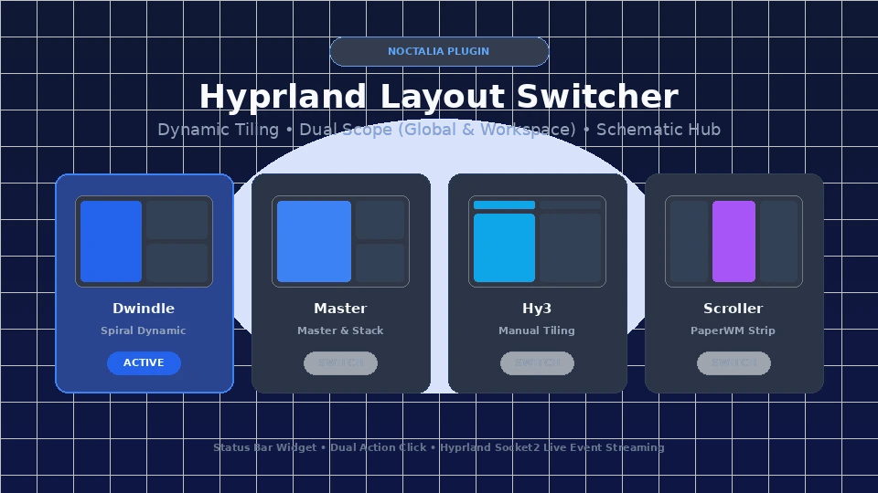

# Hyprland Monitor Manager (`rigelyon/hypr-monitors`)

Aesthetic, native visual display manager plugin for [Noctalia](https://github.com/noctalia-dev/noctalia) on the Hyprland Wayland compositor.



## Features
- **Proportional Visual Canvas**: Visually inspect active screens scaled to their real aspect ratios in a clean, modern interface.
- **Gapless Snap Alignment**: Single-click alignment tools (*Snap Left*, *Snap Right*, *Above*, *Below*, *Align Tops/Bottoms*) that calculate exact virtual offsets to prevent mouse cursor traps and subpixel seams.
- **Instant Display Presets**: Quickly toggle between *Extend*, *Duplicate/Mirror*, *Single Screen (Laptop Only)*, and *External Screen Only*.
- **Per-Monitor Inspector**: Granular control of detected hardware resolutions, refresh rates, fractional scaling (1.0x to 2.0x), and 4-way orientation (0°, 90°, 180°, 270°).
- **Persistent Lua Config Generation**: Config-only approach writing clean `hl.monitor({...})` rules directly to `~/.config/hypr/hypr-monitors.lua` with automatic `.bak` backups and instant `hyprctl reload`.
- **15-Second Safety Revert Timer**: Automatic fallback countdown protecting against black screens or unsupported display timings.
- **Display Profiles**: Save and activate named display profiles ("Office Dual", "Presentation Mirror", "Mobile Laptop") with persistent storage.
- **Dual-Action Status Bar Widget**: Status bar icon with active screen counter and rich summary tooltips; left-click or right-click opens the visual manager panel.

## Installation & Setup
1. Enable the plugin in your Noctalia settings or `plugins` configuration.
2. Ensure your `~/.config/hypr/hyprland.lua` loads the generated monitors configuration:
```lua
pcall(require, "hypr-monitors")
```
3. Open the plugin via the status bar widget or with the IPC command:
```bash
noctalia-shell ipc "panel:toggle rigelyon/hypr-monitors:panel"
```

## License
MIT © rigelyon
