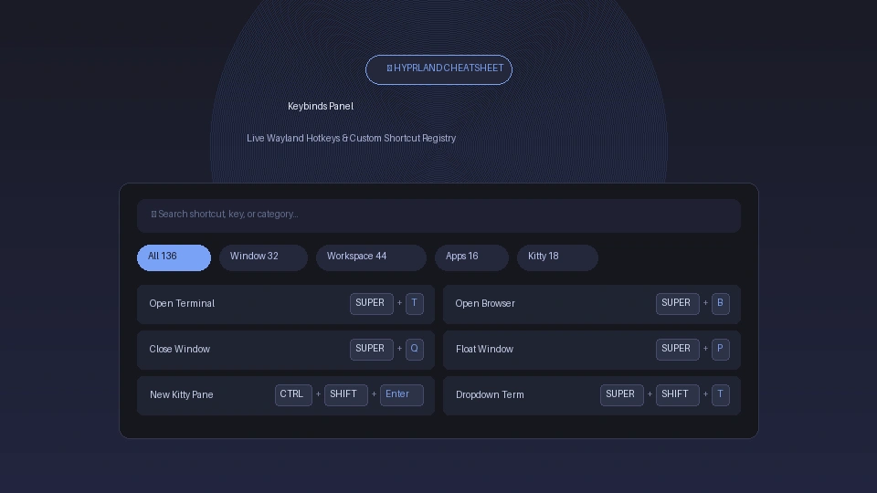

# Keybinds Cheatsheet



A sleek, aesthetic cheatsheet panel for Linux Hyprland keybindings paired with a customizable manual shortcut registry for terminal applications, shell commands, and custom tools.

## Plugin

| Field | Value |
| --- | --- |
| ID | `rigelyon/keybinds` |
| Entries | Bar widget: `widget`; panel: `panel` |

## Requirements

- `hyprland`: For dynamic Wayland keybinding discovery (`hyprctl`).
- Noctalia v5 (Plugin API 28+).

## Usage

Add the `widget` bar widget to your status bar layout in Noctalia Settings, or click it to open the cheatsheet. You can also toggle the `panel` directly from a Hyprland keybind or terminal command:

```sh
noctalia msg panel-toggle rigelyon/keybinds:panel
```

To bind this in your Hyprland configuration (`~/.config/hypr/configs/keybinds.lua`):

```lua
hl.bind("SUPER + F1", hl.dsp.exec_cmd("noctalia msg panel-toggle rigelyon/keybinds:panel"), { description = "Open Keybinds Cheatsheet" })
```

### Features

- **Live Hyprland Sync**: Queries active keybindings directly from `hyprctl binds -j`. Updates instantly when Hyprland reloads.
- **In-Panel CRUD Management**: Add, edit, or delete custom keybindings directly inside the panel using an interactive modal dialog with modifier toggle chips (`SUPER`, `CTRL`, `ALT`, `SHIFT`).
- **Expanded 3-Column Layout**: Generous `1280 × 720 px` floating panel providing ~413px per column to minimize text truncation on long descriptions.
- **Smart Auto-Categorization**: Intelligently groups shortcuts per app with subcategories sorted alphabetically (A–Z).
- **Physical `<kbd>` Visual Styling**: Displays modifier combinations (`SUPER`, `CTRL`, `ALT`, `SHIFT`) and special keys formatted like physical mechanical keyboard keys.
- **Instant Multi-Word Search**: Filter shortcuts by description, key name, or category in real-time.
- **Click to Copy & Tooltip Preview**: Click any shortcut card to instantly copy the key combination string to clipboard, or hover to view full unclipped description and key combo.
- **Decoupled Custom Registry**: Includes built-in presets for Kitty Terminal, Shell CLI, and Neovim stored in `~/.local/state/noctalia/plugins/data/rigelyon/keybinds/custom_keybinds.json`.

### Managing Custom Keybinds

You can manage your custom shortcuts in two ways:
1. **Directly from the Panel UI (Recommended)**:
   - Click the `+` icon button in the header bar to add a new keybind.
   - Hover over any custom shortcut card and click the **pencil** icon to edit or the **trash** icon to delete.
2. **Via JSON File**:
   - Edit `~/.local/state/noctalia/plugins/data/rigelyon/keybinds/custom_keybinds.json` directly:

```json
{
  "apps": [
    {
      "name": "Kitty Terminal",
      "icon": "terminal",
      "subcategories": [
        {
          "name": "Tabs & Windows",
          "icon": "app-window",
          "binds": [
            { "keys": ["CTRL", "SHIFT", "Enter"], "description": "New Pane" },
            { "keys": ["CTRL", "SHIFT", "T"], "description": "New Tab" }
          ]
        }
      ]
    }
  ]
}
```

## Settings

| Setting | Type | Default | Description |
| --- | --- | --- | --- |
| `custom_file_path` | `string` | `~/.local/state/noctalia/plugins/data/rigelyon/keybinds/custom_keybinds.json` | Path to manual JSON shortcut definitions. |
| `copy_on_click` | `bool` | `true` | Automatically copies the key combination to clipboard when clicking a card. |
| `grid_columns` | `select` | `3` | Number of columns to display in the shortcuts grid (`1`, `2`, or `3`). |

## Notes

- Binds are fetched dynamically via `hyprctl binds -j` on panel open and manual refresh.
- If Hyprland is unavailable, custom keybinds remain accessible.
